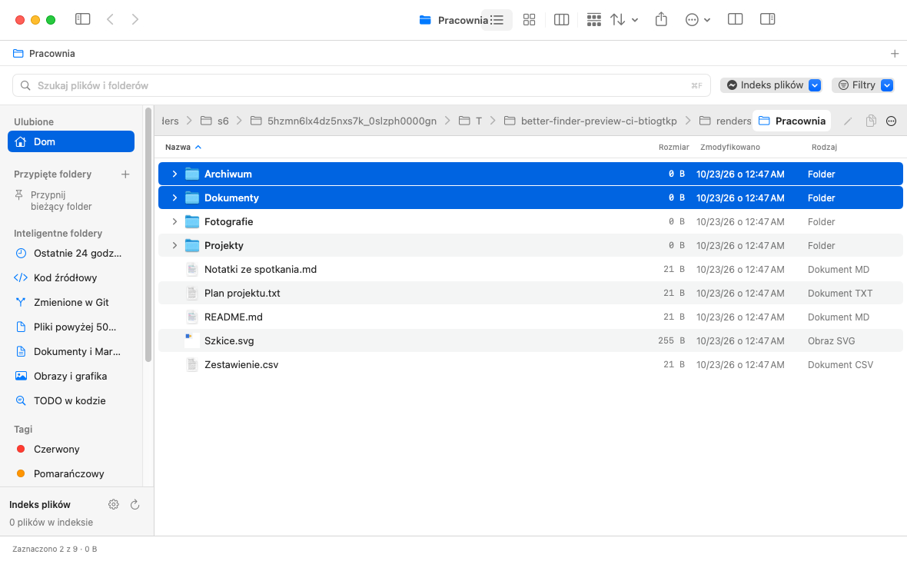

# Burrow

**A native macOS file manager with dual-pane browsing, indexed search, and disk analysis.**

Burrow brings everyday file operations and developer tools into one SwiftUI and AppKit app. Browse two folders side by side, find files with structured queries, inspect metadata, and explore what is taking up space without leaving the window.

[Get started](#get-started) · [Features](#features) · [Search syntax](#search-syntax) · [Keyboard shortcuts](#keyboard-shortcuts) · [Development](#development)



*Earlier native light-mode view render using synthetic files. It predates the latest sidebar and address-bar changes; it is not a desktop screenshot or proof of current GUI validation.*

## Project status

Burrow is under active development. This README describes the source revision containing it. Changes viewed on a pull request branch are not part of `main` until merged. See the [open pull requests](https://github.com/MaciejWlodarski/burrow/pulls) for ongoing work, and check the results for the exact revision you are evaluating. Documented features and the presence of tests do not imply that a revision has passed native testing.

The app's interface is currently mostly in Polish, with some English labels. This README is in English; it does not indicate that the app has been fully translated.

Use backups and disposable test files when trying destructive operations. See [Data, permissions, and safety](#data-permissions-and-safety) before working with important files.

## Get started

### Requirements

- **macOS 14 Sonoma or later.** The app uses macOS-only frameworks.
- **Apple Command Line Tools or Xcode**, with Swift and a macOS SDK available through `xcrun`. `Package.swift` declares Swift tools version **5.10**; this is not a guarantee that every compiler version from 5.10 onward has been tested.
- **Git** to clone the repository.

### Build and launch

A plain clone selects the default branch. To evaluate a pull request, check out its branch after cloning and before running the build commands below.

```sh
git clone https://github.com/MaciejWlodarski/burrow.git
cd burrow
```

Build and launch the checked-out revision:

```sh
zsh ./build_app.sh
open Burrow.app
```

The build script compiles an optimized app for your Mac's current architecture, generates its icon, and applies a local ad-hoc code signature. It creates `Burrow.app` in the repository root. This is a local development build, not a notarized distribution build.

An existing app bundle is kept until compilation, icon generation, and signing succeed. The script uses a private temporary build directory and removes it when finished.

## Features

### Browse your way

- **Dual panes** for side-by-side browsing, folder comparison, and copying a selection to the other pane.
- **Four views:** list, icon grid, Miller columns, and a WizTree-style disk map: a full-depth treemap with an expandable size tree. **Whole disk** scans the entire volume; folders inside a finished scan open instantly.
- **Tabs** with duplication, reopening closed tabs, and [opt-in resumption of restored views](#session-restoration) across both panes.
- **An always-visible address field in each pane.** Click it or press **⌘L** to edit; **Return** navigates and **Escape** cancels. Paths support `~` and relative locations.
- **Adjustable layout** with resizable panes, an optional sidebar and inspector, and system light and dark appearances.

Back and Forward validate the destination before changing the current folder or history. If a destination is missing, unreadable, or no longer a directory, the current location, listing, and history are retained and an error is shown. Hiding and showing the right pane preserves its established location.

The sidebar has one **manually ordered Favorites list**. Add folders, rename their labels, remove them, or reorder them by drag or the row menu. Existing pins migrate into the list; unavailable locations are retained. Defaults initialize the list once, and an explicitly empty list stays empty. Damaged or unsupported saved data is not silently overwritten.

Mounted network shares are grouped by their known server endpoint, with separate share rows and expandable server headings. Unknown server metadata falls back without inventing a host. Unknown capacity is not shown as zero free or a full disk. Volumes refresh in the background; failures retain the last-known rows with a warning. The server heading is not itself a navigable filesystem folder or a collective eject action.

The system Trash favorite opens **Finder's Trash**, even after its label is renamed, rather than trying to browse the protected `.Trash` directory. Other inaccessible folders retain the current location and show a readable permission message. This does not grant additional macOS permissions.

### Find files

- Search the **current folder**, its **subfolders**, or the **configured file index**.
- Combine names with extension, size, modification-time, path, file-type, tag-color, content, and Git-status filters.
- Use fuzzy matching, quoted phrases, exclusions, and regular expressions.
- The built-in engine uses bulk filesystem enumeration, an in-memory index, an optional persistent metadata cache, and FSEvents updates. No separate search service is required for the built-in engine.

### Work with files

- Copy, cut, paste, duplicate, rename, create files and folders, and move items to Trash.
- Drag selections from the list or icon grid; hold **Option** to request a copy.
- Use conflict handling and identity-checked, in-memory undo/redo for supported file operations.
- Work with Finder tags, Open With, sharing, and archive creation or extraction.
- Inspect previews, metadata, POSIX permissions, and SHA-256 or MD5 checksums; use **Quick Look** for a larger preview.

### Explore folders and projects

- Visualize disk usage and inspect large files in the analysis view.
- Find duplicate candidates using file sizes and SHA-256 hashes, with content and identity revalidation before cleanup. Review them before deleting anything.
- See Git-status information for files in a repository.
- Run shell commands in a **resizable, tabbed command drawer**. Each new command tab starts in the active folder, then keeps its own directory, draft and output. It invokes `zsh -c`; it is **not a full interactive terminal emulator**.

Folder sizes are calculated in bounded background work, with inspector selections prioritized over visible rows and background size-sorting requests. Work beyond the admission limit is marked deferred, not silently queued forever. Use the retry control after narrowing the view or closing other views; refreshing, changing the selection, or showing a row again can also retry deferred requests.

Incomplete scans display **≥** to mark a lower bound, not an exact size. Cancellation is cooperative: a blocked filesystem call can still occupy a worker, so leaving a folder does not guarantee immediate interruption of its scan.

The command drawer supports up to eight tabs. Drag its separator to resize it, or focus the separator and use the arrow keys; its menu also provides resize and reset actions. Hiding the drawer or switching tabs does not cancel a command. Closing a command tab requests cancellation of its command; cleanup remains application-owned.

Each command runs in a fresh, noninteractive `zsh`. A simple standalone `cd`, including a quoted path or `~/…`, changes that command tab's directory after successful completion, without navigating the file pane. Compound commands run unchanged in the shell; their directory changes do not carry into the next command. Completion of commands other than recognized standalone `cd` requests a bounded refresh for the command's original directory. Console output is bounded: long entries may be shortened and older entries removed, with visible notices. Display truncation does not shorten the executed command. Tab state is not restored after app restart.

## Search syntax

Type a query into the search bar or open quick search with **⌘P**.

| Query | Purpose |
| --- | --- |
| `report ext:pdf` | Find PDFs matching “report” |
| `size:>10mb mtime:<7d` | Find files over 10 MiB modified within the last 7 days |
| `size:=1.5kb` | Match exactly 1,536 bytes |
| `type:image` | Filter by image type |
| `in:Sources grep:TODO` | Look for TODO content in matching source paths |
| `git:modified` | Filter by recorded Git status |
| `"annual report" !draft` | Match a phrase and exclude a term |
| `!ext:log` | Exclude an extension |

Additional syntax includes `regex:`, `tag:`, `^prefix`, and `suffix$`. The Filters menu provides syntax help and removable filter chips.

- **Exclusions:** `!` or `-` can exclude ordinary terms and extension filters (`!ext:log` or `-ext:log`). Negating other recognized filters, such as `!type:image`, shows a diagnostic and returns no results rather than ignoring the restriction.
- **Invalid values:** malformed filter values, such as `size:huge`, `sym:maybe`, or `ext:pdf,`, show a diagnostic and return no results. Unknown keys and empty values, such as `unknown:value` and `ext:`, remain ordinary search terms rather than active filters.
- **Sizes:** `kb`, `mb`, and `gb` use binary units, as do `kib`, `mib`, and `gib`. Use `=` for an exact byte count; a bare value means “at least.” Decimal quantities are scaled without floating-point rounding, then fractional bytes are discarded. Out-of-range values are rejected.
- **Filename matching:** name terms are lowercased and normalized to Unicode NFC, so composed and decomposed spellings match without changing the original filenames or paths. This normalization does not apply to regex, content, or path predicates. Fuzzy typo tolerance and subsequence matching still operate on normalized UTF-8 bytes, not full Unicode character edit distance.

**The index is not the entire disk.** Even where the UI calls it “Whole Disk (fsearch),” it covers configured roots, subject to exclusions, permissions, and search limits. On first use, default roots include existing Desktop, Documents, Downloads, `dev`, `Projects`, and `Developer` folders in your home directory, plus `/Applications`. Review the indexing settings before relying on its coverage. After saving, your configured roots, excluded directory names, heavy-development-folder exclusion setting, and persistent-cache setting are retained across launches. An explicitly empty root list stays empty; saved offline locations are retained rather than replaced with defaults.

Content search and Git filters also have bounded coverage. Partial results are indicated when a limit is reached or some data cannot be read. A search result is not an exhaustive filesystem or repository audit.

The Smart Folders sidebar and save-search control are no longer exposed. Existing saved-search records are retained for compatibility; removing those controls does not delete their stored data.

## Keyboard shortcuts

| Shortcut | Action |
| --- | --- |
| ⌘T / ⌘W | New tab / close the active tab or pane, or the last window |
| ⇧⌘T | Reopen a closed tab |
| ⌃Tab / ⇧⌃Tab | Next / previous tab |
| ⌘F / ⌘P | Focus search / open quick search |
| ⌘L / ⇧⌘G | Enter a folder path |
| ⌘[ / ⌘] / ⌘↑ | Back / forward / parent folder |
| ⌘↓ | Open the selected item |
| ⌘R | Refresh the folder and active search |
| ⌘1 / ⌘2 / ⌘3 / ⌘4 | List / icons / columns / disk analysis |
| ⌘A / ⇧↑ or ⇧↓ | Select all / extend the selection |
| Return | Rename the selected item |
| Space / ⌘Y | Toggle Quick Look |
| ⇧⌘N / ⌥⌘N | New folder / new file from a template |
| ⌘C / ⌘X / ⌘V | Copy / cut / paste |
| ⌥⌘C / ⌘D | Copy paths / duplicate selection |
| ⌘Delete | Move the selection to Trash |
| ⌘Z / ⇧⌘Z | Undo / redo |
| ⇧⌘. | Toggle hidden files |
| ⌃⌘S / ⌘I | Toggle sidebar / inspector |
| ⇧⌘D | Toggle dual panes |
| Control + backtick | Toggle the command drawer |
| ⌘, | Open settings |

Text-editing commands act on the focused text field rather than the file selection. Selection and preview shortcuts apply when a file view, not a text field or modal, has focus.

## Session restoration

The session stores tab order, both panes, the active side, view mode, sorting, hidden-file and fuzzy settings, and the query with its scope. Restored views start **paused**. Choose “Wznów zapisany widok” (Resume saved view) to read that folder and run its saved search or analysis. Restoration does not automatically open every saved folder at startup.

A saved whole-index search can show results without opening a paused folder; clearing that query leaves the folder paused. Unavailable locations retain their paths and settings so you can retry or choose another location. A timeout does not mean the folder was deleted. Restoration does not add locations to the index; ordinary startup indexing of previously configured roots is a separate mechanism.

In Settings:

- **“Zapisuj i przywracaj sesję” (Save and restore session)** takes effect immediately, separately from saving index settings. Turning it off stops new saves and restoration but retains the previous record. Turning it back on saves the current layout.
- **“Wyczyść zapis sesji i wyłącz przywracanie” (Clear saved session and disable restoration)** removes the saved session and legacy tab-path record, then disables further session saves until re-enabled. It does not close tabs or delete Favorites and retained legacy saved-search records.
- Unsupported or damaged session records are protected against overwriting until explicitly cleared.

Selection, clipboard contents, undo/redo history, command-drawer state, analysis results, and unfinished operations are not restored. Session data is stored locally and is not sent or synchronized by the app. Named workspaces are not supported yet.

## Previews and thumbnails

The inspector prepares bounded image and text previews in the background and discards cancelled or superseded results. Its quick preview supports regular files, not symlinks or devices. Image previews are limited to 32 MiB and 40 megapixels, with a maximum 768-pixel thumbnail dimension. Text previews read at most the first 24 KiB; they are excerpts, not a full-file viewer. Use retry or Quick Look when a quick preview is unavailable.

Inspector preview work is limited to two running and two queued requests. Cancellation is cooperative: it does not guarantee immediate interruption of a blocked filesystem read or image decoder.

Icon-grid thumbnails have separate limits for active requests, queued work, and cached results, with timeouts, delayed bounded retries, and stale-callback rejection. Thumbnail provider cancellation is best effort. Releasing a timed-out request's logical slot does not guarantee that the system provider has stopped its underlying work. Quick Look depends on macOS and installed preview providers; a preview is not a guarantee that a file is safe to open.

## Data, permissions, and safety

### Local data and access

Saved indexing configuration, Favorites, retained legacy saved-search records, and session state are stored locally through macOS preferences. The optional index cache contains filenames, paths, and metadata. Its preferred location is `~/Library/Caches/Burrow/fsearch_index.bin`; a validated private temporary directory is used as a fallback. If no suitable private location is available, caching is skipped. Paths and filenames may be sensitive.

If saved index settings are damaged or from an unsupported version, startup automatic indexing and cache writing stay paused rather than falling back to default roots. Settings offers an explicit repair option that preserves a copy of the original record before replacing it. Turning persistent caching off prevents new cache writes from being authorized, but an already-authorized write may finish; it does not delete an existing cache.

Browsing, indexing, and previews depend on your account's permissions and macOS privacy controls. Inaccessible locations may be missing from results. Grant access only to locations you intend the app to use. Shell commands run with your user's access; do not run unfamiliar commands.

### File operations and recovery

Replacement handling stages incoming data, attempts to preserve the previous item in Trash, and attempts rollback after a failure. Undo/redo tracks both sides of a replacement. Pending steps remain available after a partial failure; recovery messages identify retained data when automatic restoration fails.

History actions check the recorded filesystem identity before acting, rather than trusting that a path still names the original object. A missing, changed, or unverifiable identity leaves the action pending. These checks are not content snapshots and do not lock files against changes by other apps.

**Undo is not a backup.** History is in memory, not a durable recovery journal, and does not survive an app restart or crash. Keep backups of important files. Cancellation of a multi-file transfer happens between files, not halfway through the current file. Emptying Trash requires confirmation and is irreversible.

Archive creation and extraction stage output in a private working directory before publishing without replacing an existing destination. If the volume cannot support the required exclusive publication, the operation fails; messages identify any retained working data.

Changing a Finder tag color preserves custom named tags. The separate Remove all tags command deliberately removes them.

### Comparison, analysis, and Git

Folder comparison examines **direct children**, not a recursive synchronization tree. Shared subfolders are marked as unexamined; type conflicts require manual resolution. Regular files are compared by content and modification time, and replacement requires a conflict-policy choice.

Analysis scans have an entry cap; folder comparison has a combined listing cap across both sides. Incomplete analysis totals are lower bounds, marked **≥** or “at least.” An incomplete comparison listing disables copying rather than treating missing entries as differences.

Analysis, comparison, and duplicate verification share bounded background capacity. Busy requests can be deferred for an explicit retry. Cancel stops queued or cooperative work and prevents stale results from replacing the current view; it cannot guarantee interruption of a blocked system read.

Dedicated duplicate cleanup requires a complete, current scan and rechecks content and identity, including the copy being retained. Cleanup runs in the background; Cancel stops further steps but does not undo a Trash operation already in progress. Available recovery records are grouped into one Undo operation, even after partial completion. If Trash returns no recovery URL, Undo cannot restore that item; if its recovery identity cannot be verified, the record stays pending and cannot currently run. Read the completion summary and inspect the folder and Trash after an uncertain outcome.

These checks do not prevent another application from writing concurrently. Inspect the actual files before cleanup or replacement.

Automatic Git inspection disables executable fsmonitor helpers and clean/process filters, and skips submodule contents. It compares raw files: repositories using filters such as Git LFS can appear modified even when trusted Git reports them clean. An inspection error or exceeded limit means status is unavailable, not that the repository is clean. These restrictions are not a general sandbox for repositories or commands you run yourself.

## Development

### Run regression checks

On a Mac with the build requirements installed:

```sh
zsh ./scripts/run_tests.sh
```

The script compiles the production models, engines, and views with `BURROW_TESTING`, then runs the regression runner and a separate file-operation harness. It uses a temporary home directory, preferences, and test fixtures to isolate regression startup from normal user state. The harness exercises replacement, rollback, history, clipboard ownership logic, and tag metadata. Replacement tests use a fixture-local substitute for Trash.

This isolation applies to the regression runner, not the native preview harness below. It is not a general-purpose OS sandbox.

Use the repository's runner rather than assuming `swift test` is equivalent: `Package.swift` currently declares an executable target, not a test target.

### Preview the native UI

Run the preview harness in a disposable macOS account or test environment. It remains unisolated and can still read real user locations and write preferences; a separate app bundle does not make it isolated.

From an active graphical macOS session:

```sh
zsh ./scripts/preview_app.sh
```

This experimental local harness builds a separate preview app and attempts keyboard checks and native view renders in `.build/previews`. Its scenarios cover list and search views, a narrow window, dual panes, the inspector, renaming, and dark-mode icons, but a run may stop before completing them. In particular, legacy-seeded sessions can restore paused views that do not satisfy its initial selection checks. Any renders produced are not desktop screenshots or a substitute for full interactive UI validation.

### Branch-specific validation

The repository includes `.github/workflows/macos-regressions.yml`, which builds the app and runs regression checks on macOS 26 only. The minimum deployment target remains macOS 14; the current CI matrix does not validate compatibility with that older system. Consult the actual checks on the [relevant pull request](https://github.com/MaciejWlodarski/burrow/pulls); the presence of a workflow is not evidence that a particular revision has passed. A successful check on one branch does not establish that `main` or a newer integrated revision passes the same suite. Automated checks do not replace interactive testing of Quick Look, permissions, filesystem events, external volumes, or Thread Sanitizer runs.

### Contributing

Keep changes focused and include reproduction steps for bugs. For a file-operation issue, describe the source and destination volumes, the operation, expected behavior, and actual result. Use disposable fixtures and redact private paths from logs.

Before proposing a change, review the [open pull requests](https://github.com/MaciejWlodarski/burrow/pulls) to avoid duplicating ongoing work. Run the relevant regression checks and note your macOS version, Swift version, and any manual UI testing in the pull request.
