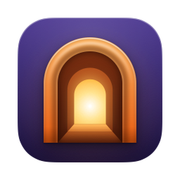
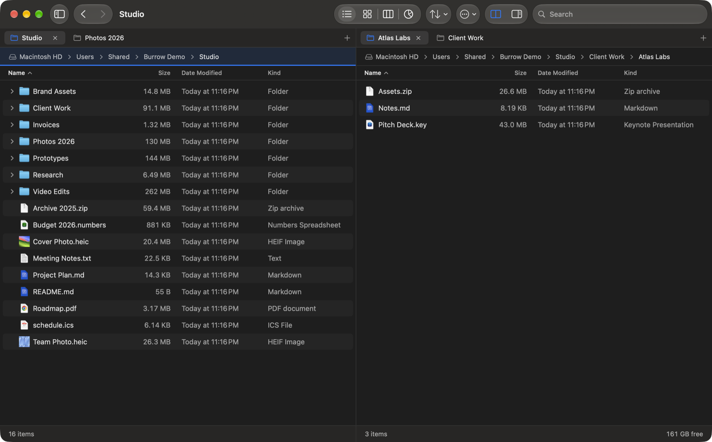
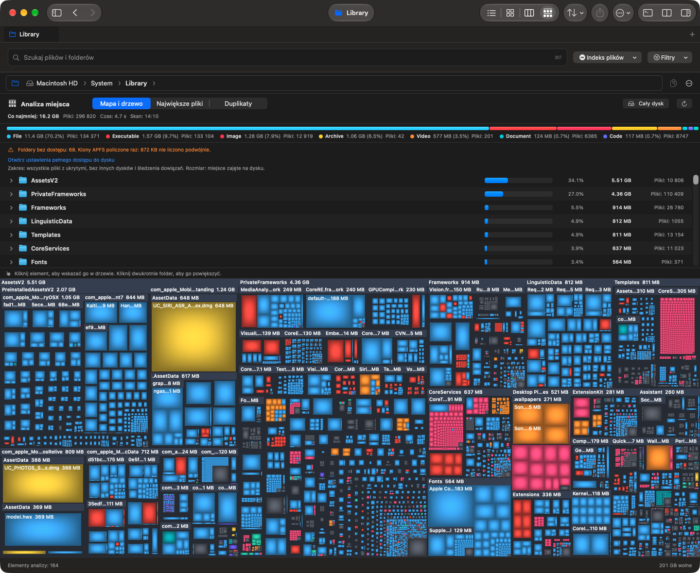

<p align="center">
  
</p>

<h1 align="center">Burrow</h1>

<p align="center">
  <b>A native macOS file manager that also tells you where your disk went.</b><br>
  Dual panes, an Explorer-style address bar, fsearch-style indexed search,<br>
  a WizTree-style map of the whole disk, iCloud Drive, Google Drive and OneDrive in the sidebar,<br>
  and a <code>burrow</code> CLI for scripts and AI agents.
</p>

<p align="center">
  <a href="https://github.com/MaciejWlodarski/burrow/releases/latest"></a>
  <a href="https://github.com/MaciejWlodarski/burrow/actions/workflows/ci.yml"></a>
  
  
  
  
  <a href="LICENSE"></a>
</p>

<p align="center">
  <a href="#highlights">Highlights</a> ·
  <a href="#disk-map">Disk map</a> ·
  <a href="#search">Search</a> ·
  <a href="#the-burrow-cli">CLI</a> ·
  <a href="#install">Install</a> ·
  <a href="#roadmap">Roadmap</a> ·
  <a href="docs/GUIDE.md">Guide</a>
</p>

https://github.com/user-attachments/assets/f77dc4a6-53f4-4fc8-901d-6c9d21b7db0c



## Highlights

| | |
|---|---|
| **Dual panes and tabs** | Two folders side by side, tabs in each, copy to the other pane, compare folders. |
| **Four views** | List with expandable folders, icon grid, Miller columns, and a disk map (⌘1–⌘4). |
| **Explorer-style address bar** | Click any folder in the path to jump there, or the › after it to pick a subfolder. Click the empty space or press ⌘L to type a path. |
| **Indexed search** | Results as you type over an in-memory index, with fsearch-style filters, typo tolerance and content grep. |
| **Whole-disk map** | A full-depth treemap and size tree of the entire disk in about 20 seconds. APFS clones and hard links count once. |
| **`burrow` CLI and MCP server** | The same scanner from the terminal or as MCP tools for AI agents, with JSON output, a reusable scan cache, regenerable-clutter detection and a Trash-only `trash` command. |
| **Network servers** | **Connect to Server** (⌘K) mounts SMB, AFP, NFS and WebDAV shares, with recent servers and the system sign-in. Shares are grouped under their server in the sidebar, show their real free space, and items on a disk without a Trash can be deleted after a warning, as in Finder. Saved shares stay in the sidebar while disconnected, like mapped drives on Windows, and a click connects them again. |
| **Cloud storage** | iCloud Drive, Google Drive, OneDrive, Dropbox and other File Provider apps appear under **Cloud** in the sidebar. A cloud badge marks files stored only online; **Download Now** and **Remove Download** are in the context menu. Searching, folder sizes and previews never download anything by themselves. |
| **Per-folder sorting and views** | One default in Settings; sort Downloads by date or show Pictures as icons, and only that folder remembers it. |
| **Replaces Finder** | Optionally the default folder viewer: folders opened from the Dock, Spotlight, `open` and “Show in Finder” land in Burrow. |
| **Everyday file work** | Copy, move, rename, duplicate, tags, archives, Quick Look, checksums, Git status, duplicate finder, undo/redo, a command drawer. |

Burrow is a single native app with no third-party dependencies. It is built from source with Apple's command-line tools.

## Disk map



Press **⌘4** and choose **Scan Whole Disk**, or map any folder. Burrow works like WizTree, but on macOS:

- **Fast whole-disk scans.** Eight parallel `getattrlistbulk` workers. On the author's Mac a scan of about 3.9 million entries takes around 20 seconds.
- **Every level at once.** The treemap shows the full depth, not just the top folders. Hover for details, click to reveal an item in the tree, double-click to zoom in without rescanning.
- **Honest numbers.** Sizes are on-disk bytes. Hard links and unmodified APFS clones (Finder copies, system images) are counted once. Other disks, snapshots, cloud-only files and grafted cryptex images are skipped.
- **Nothing hidden.** Space the scan could not attribute, such as protected system data or folders without access, appears as one “unscanned” block, so the total matches the used space on the disk.
- **Cleanup in place.** Move items to the Trash from the map; the tree updates without a rescan.

## Search

Search the current folder, its subfolders, or the whole index. Burrow's engine uses the query language of [**fsearch**](https://github.com/noahdunnagan/fsearch), the whole-disk search tool for macOS by Noah Dunnagan:

```text
report ext:pdf                 PDFs matching "report"
size:>10mb mtime:<7d           over 10 MB, changed in the last week
type:image in:~/Pictures       images under a folder
in:Sources grep:TODO           TODO inside files under Sources
git:modified                   files with uncommitted changes
"annual report" !draft         a phrase, excluding a word
^IMG_ .heic$                   prefix and suffix
```

Words are fuzzy and forgive typos. Also supported are `regex:`, `tag:`, exclusions with `!` or `-`, and removable filter chips. Press **⌘P** for a quick search window.

Under the hood, the built-in engine is a Swift implementation of the same design: a bulk `getattrlistbulk` crawl, a compact in-memory index with an optional persistent cache, FSEvents updates, and trigram filters that skip files that cannot match a content search. Burrow indexes the folders you choose in Settings, not the entire disk. See the [guide](docs/GUIDE.md#search-syntax) for the exact rules.

## The `burrow` CLI

The app bundle ships a command-line tool that uses the disk map's scanner. It is designed for scripts and AI coding agents: every command prints readable text, or a single JSON document with `--json`.

```sh
burrow scan / --depth 2 --files 20 --types --junk   # whole disk: tree, largest files, types, clutter
burrow scan ~/dev --min-size 1G                       # one folder, hiding small items
burrow top ~ --ext mov,dmg,zip --older-than 180       # largest old files of some types
burrow junk                                           # caches, build outputs, node_modules in your home
burrow size ~/Downloads ~/dev/app/node_modules        # on-disk size of paths
burrow trash ~/dev/app/target --dry-run               # preview, then run without --dry-run
burrow scan / --cache --quiet && burrow junk --cache  # scan once, answer the rest from the cache
```

```text
$ burrow junk ~/dev --limit 3
Regenerable clutter (30.0 GB in 3 items; risk safe = rebuilt on demand, review = check first):
  28.0 GB  safe   ~/dev/projects/game/target          [Rust build: Rebuilt by cargo build]
   1.0 GB  safe   ~/dev/projects/site/.turbo          [JavaScript build cache: Rebuilt by the next build]
   1.0 GB  safe   ~/dev/projects/site/node_modules    [node_modules: Reinstalled by npm/pnpm/yarn install]
```

- **Clutter is labeled.** `junk` finds `node_modules`, Rust `target` and SwiftPM `.build` folders (only next to `Cargo.toml` or `Package.swift`), Xcode DerivedData, Python and JavaScript caches, app caches and more. Each item has a risk level (`safe` is rebuilt on demand, `review` needs a look first) and a hint.
- **Nothing is deleted.** `trash` only moves items to the Trash. It refuses the disk root, system folders, mounted volumes, your home and its standard folders.
- **Scan once.** With `--cache`, a scan is saved to `~/Library/Caches/Burrow/cli` and later commands for the same folder or any folder inside it reuse it for 10 minutes (`--max-age SECS` changes that, `--fresh` rescans). A whole disk takes about 30 s to scan and well under a second from the cache; its saved scan is a few hundred MB. Moving items to the Trash through `burrow` updates cached scans. `burrow cache` lists them and `burrow cache clear` removes them.
- **Predictable for agents.** Exit status is 0 on success, 1 when a scan or move fails, and 2 for invalid usage. `burrow help` lists every option.

### MCP server

`burrow mcp` serves the same commands as [Model Context Protocol](https://modelcontextprotocol.io) tools over stdio: `scan`, `top`, `junk`, `size` and `trash`. Scans stay in memory for the session, so an agent can scan the whole disk once and ask follow-up questions inside it instantly; `fresh: true` rescans. `trash` only reports what it would move unless the call passes `dry_run: false`, and the same protected folders are refused.

```sh
claude mcp add burrow -- burrow mcp      # Claude Code
```

Other clients take the usual entry: `{"mcpServers": {"burrow": {"command": "burrow", "args": ["mcp"]}}}` (use the full path `/Applications/Burrow.app/Contents/Helpers/burrow` if the client does not see your `PATH`). Add `--cache` to also keep the session's scans on disk for the next one.

## Install

**Requirements:** macOS 15 Sequoia or later, on Apple silicon or Intel.

**Download.** Get [**Burrow.dmg**](https://github.com/MaciejWlodarski/burrow/releases/latest/download/Burrow.dmg) from the [latest release](https://github.com/MaciejWlodarski/burrow/releases/latest), open it and drag Burrow to Applications.

**Homebrew.** The cask also links the `burrow` CLI:

```sh
brew tap maciejwlodarski/burrow https://github.com/MaciejWlodarski/burrow
brew install --cask burrow
```

**First launch.** Burrow is open source but not notarized by Apple (that needs a paid developer account), so macOS asks you to confirm it once:

1. Open Burrow. macOS says it cannot check it for malicious software; click **Done**.
2. Open **System Settings → Privacy & Security**, scroll to **Security** and click **Open Anyway** next to the message about Burrow. Confirm with your password.
3. Open Burrow again and choose **Open**. macOS remembers the choice for this copy of the app.

From Terminal the same is `xattr -dr com.apple.quarantine /Applications/Burrow.app`.

On first launch Burrow offers to set up **Full Disk Access**: with it, folder sizes, search and the disk map cover protected folders without a prompt for each. You can skip it; protected folders are then sized when you ask. Releases from 0.1.1 on are signed with the same certificate, so updates keep that permission. Version 0.1.0 was signed ad hoc: after updating from it, grant Full Disk Access once more.

The interface follows the macOS language (English or Polish). To choose one, open **Settings → Language**.

### Build from source

You need the Xcode 16 or newer command-line tools (`xcode-select --install`). There is no Xcode project and no third-party dependency.

```sh
git clone https://github.com/MaciejWlodarski/burrow.git
cd burrow
zsh scripts/setup_signing.sh   # once: a local signing identity, so permissions survive rebuilds
zsh scripts/update.sh          # build, install to /Applications, link the burrow CLI
```

`update.sh` is also how you update a source build: it builds, quits a running Burrow, replaces `/Applications/Burrow.app`, relaunches it and removes the build from the repository. It links `burrow` into `/opt/homebrew/bin`, `/usr/local/bin` or `~/.local/bin`, whichever is writable first.

**Why the signing step?** macOS ties Full Disk Access and folder permissions to an app's code signature. An ad-hoc signature changes with every build, so each rebuild would lose them. `setup_signing.sh` creates a self-signed “Burrow Local Signing” certificate in its own keychain under `~/Library/Application Support/Burrow/Signing`, and every later build is signed with it. Grant Full Disk Access once and it stays.

To try a build without installing it, run `zsh ./build_app.sh` and `open Burrow.app`.

## Keyboard shortcuts

| Shortcut | Action |
| --- | --- |
| ⌘T / ⌘W | New tab / close the active tab or pane, or the last window |
| ⇧⌘T | Reopen a closed tab |
| ⌃Tab / ⇧⌃Tab | Next / previous tab |
| ⌘F / ⌘P | Focus search / open quick search |
| ⌘L / ⇧⌘G | Edit the path |
| ⌘K | Connect to a server |
| ⌘[ / ⌘] / ⌘↑ | Back / forward / parent folder |
| ⌘↓ | Open the selected item |
| ⌘R | Refresh the folder and active search |
| ⌘1 / ⌘2 / ⌘3 / ⌘4 | List / icons / columns / disk map |
| ⌘A / ⇧↑ or ⇧↓ | Select all / extend the selection |
| Return | Rename the selected item |
| Space / ⌘Y | Toggle Quick Look |
| ⇧⌘N / ⌥⌘N | New folder / new file from a template |
| ⌘C / ⌘X / ⌘V | Copy / cut / paste |
| ⌥⌘C / ⌘D | Copy paths / duplicate selection |
| ⌘Delete | Move the selection to Trash |
| ⌘Z / ⇧⌘Z | Undo / redo |
| ⇧⌘. | Toggle hidden files |
| ⌃⌘S / ⌘I | Toggle sidebar / inspector |
| ⇧⌘D | Toggle dual panes |
| Control + backtick | Toggle the command drawer |
| ⌘, | Open settings |

## Roadmap

**Next**

- [ ] **Notarized releases.** Releases are signed with a self-signed certificate today; notarization needs a paid Apple Developer account.
- [ ] **More languages.** The interface is in English and Polish. A new language is one `Localizable.strings` file ([#40](https://github.com/MaciejWlodarski/burrow/issues/40)).
- [ ] **Optional fsearch backend.** When the [fsearch](https://github.com/noahdunnagan/fsearch) daemon is running, query its whole-disk index and content grep over its local socket instead of indexing chosen folders only.
- [ ] **Live disk map.** Keep a finished scan current with FSEvents instead of rescanning ([#44](https://github.com/MaciejWlodarski/burrow/issues/44)).
- [ ] **More cloud controls.** Keep chosen folders downloaded, show download progress as a percentage ([#43](https://github.com/MaciejWlodarski/burrow/issues/43)), and share links through the provider.

**Done recently**

- [x] **Saved network drives.** Shares stay in the sidebar when disconnected, dimmed until a click connects them, like mapped drives on Windows; optionally they connect at launch with keychain passwords.
- [x] **Connect to Server** (⌘K), deleting on network disks without a Trash, and their real free space.
- [x] **Faster CLI for agents.** `--cache` reuses a scan between commands, and `burrow mcp` serves `scan`, `top`, `junk`, `size` and `trash` to agents.
- [x] Per-folder view mode, like per-folder sorting.

**Later**

- [ ] Duplicate search built on the disk-map scan, without the current 60,000-entry cap.
- [ ] Per-folder list columns: choose which columns a folder shows ([#45](https://github.com/MaciejWlodarski/burrow/issues/45)).
- [ ] Independent state for multiple windows.
- [ ] A full terminal emulator in the command drawer (it runs `zsh -c` today).

Bug reports are welcome in [issues](https://github.com/MaciejWlodarski/burrow/issues), and questions and ideas in [Discussions](https://github.com/MaciejWlodarski/burrow/discussions). Issues labeled [good first issue](https://github.com/MaciejWlodarski/burrow/labels/good%20first%20issue) are a good place to start contributing.

## Project status

Burrow is in early, active development: an early beta, used daily by its author. Contributions are welcome; see [CONTRIBUTING.md](CONTRIBUTING.md). Expect rough edges:

- Releases are self-signed, not notarized, so the first launch needs **Open Anyway**.
- It has been tested by hand on Apple silicon; reports from Intel Macs are welcome ([#46](https://github.com/MaciejWlodarski/burrow/issues/46)).
- **Undo is not a backup.** File history lives in memory and does not survive a restart. Keep backups of important files and try destructive operations on disposable data first.

The [guide](docs/GUIDE.md) documents behavior, limits and safety checks in detail: file operations and recovery, indexing coverage, session restoration, previews, comparison and duplicate cleanup.

## Development

[CONTRIBUTING.md](CONTRIBUTING.md) covers building, tests, the code layout and conventions. The short version:

```sh
zsh ./scripts/run_tests.sh
```

The regression runner compiles the app's models, engines and views with `BURROW_TESTING` and runs them against real temporary files, with an isolated home folder and preferences. It covers navigation, search, file operations, the disk scanner, the CLI and session restoration. `swift test` is not equivalent: `Package.swift` declares an executable target only. See the [guide](docs/GUIDE.md#development) for the UI preview harness and CI notes.

**Translations.** English is the source language. Polish lives in `Resources/pl.lproj/Localizable.strings`, keyed by the English text. To add a language, copy that file to `Resources/<code>.lproj/`, translate the values and add the code to `CFBundleLocalizations` in `Resources/Info.plist`. `python3 scripts/check_localization.py` reports missing translations and mismatched placeholders.

**CI and releases.** [CI](.github/workflows/ci.yml) checks localization, builds a universal app and runs the regression suites on macOS 26 and 15. Pushing a `v*` tag runs the [release workflow](.github/workflows/release.yml), which tests, builds, signs and publishes `Burrow.dmg` and `Burrow.zip` to GitHub Releases.

## License

Burrow is available under the [MIT License](LICENSE).

## Acknowledgements

- [**fsearch**](https://github.com/noahdunnagan/fsearch) by Noah Dunnagan (MIT) for the query language and the design of fast whole-disk search on macOS that Burrow's search follows.
- [WizTree](https://diskanalyzer.com) and [Everything](https://www.voidtools.com) on Windows for showing how fast disk analysis and file search can feel.
